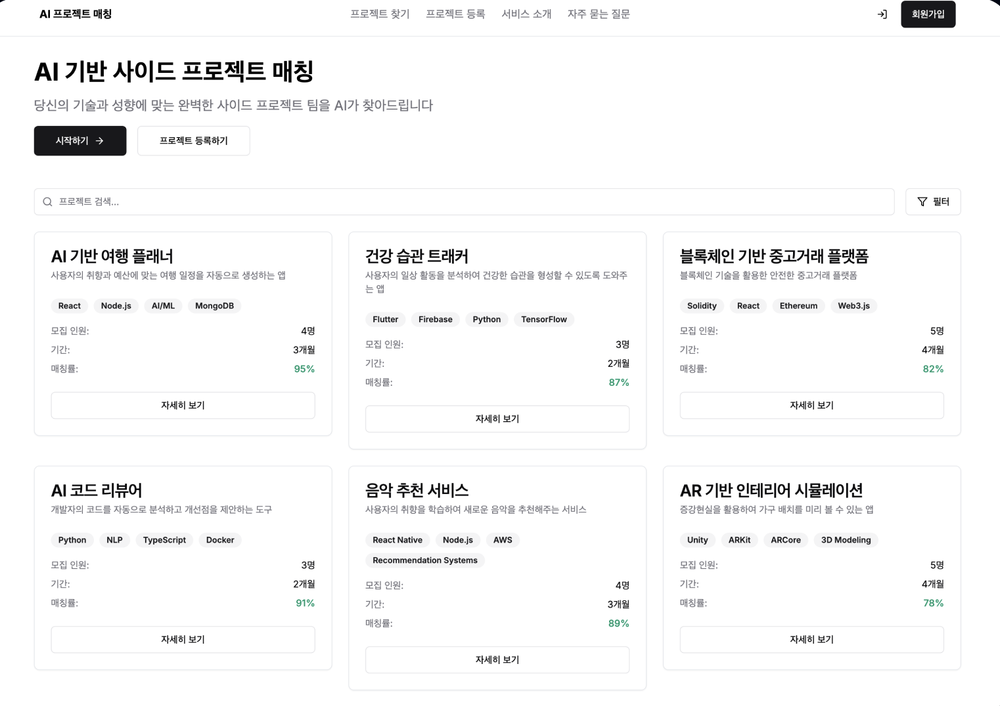
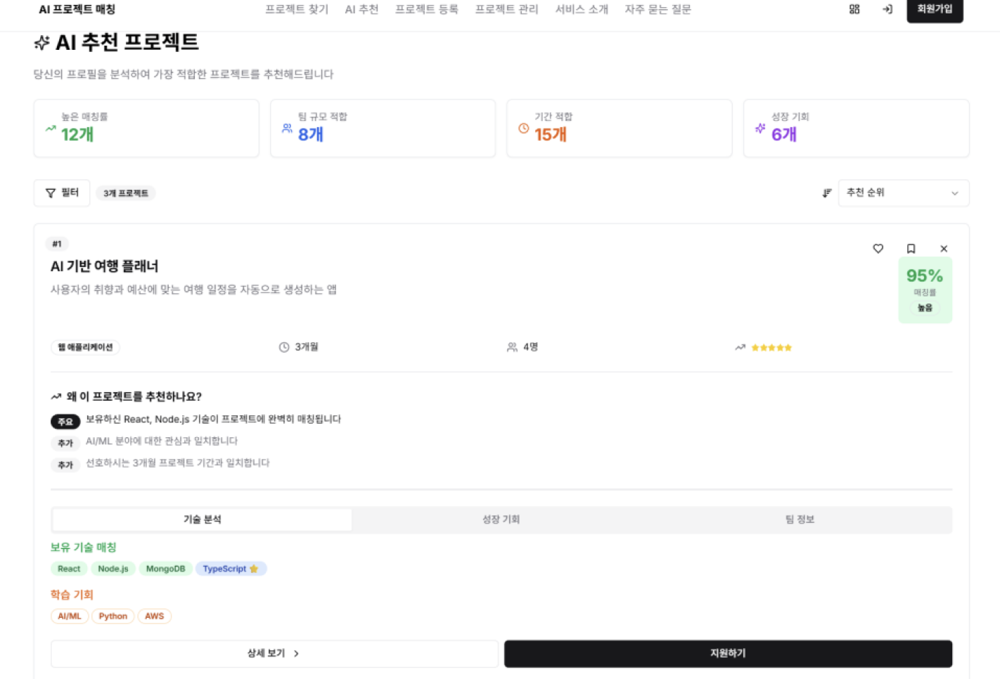
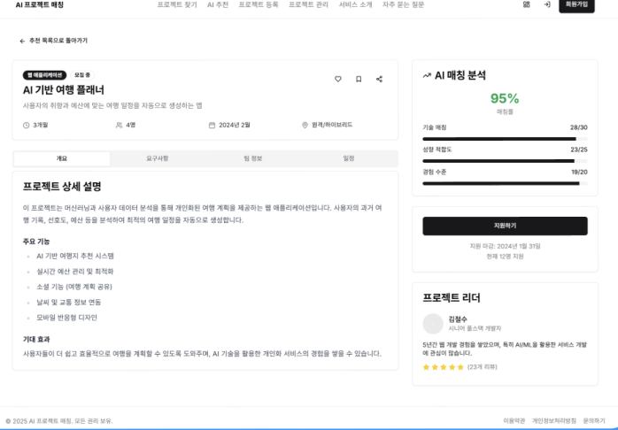
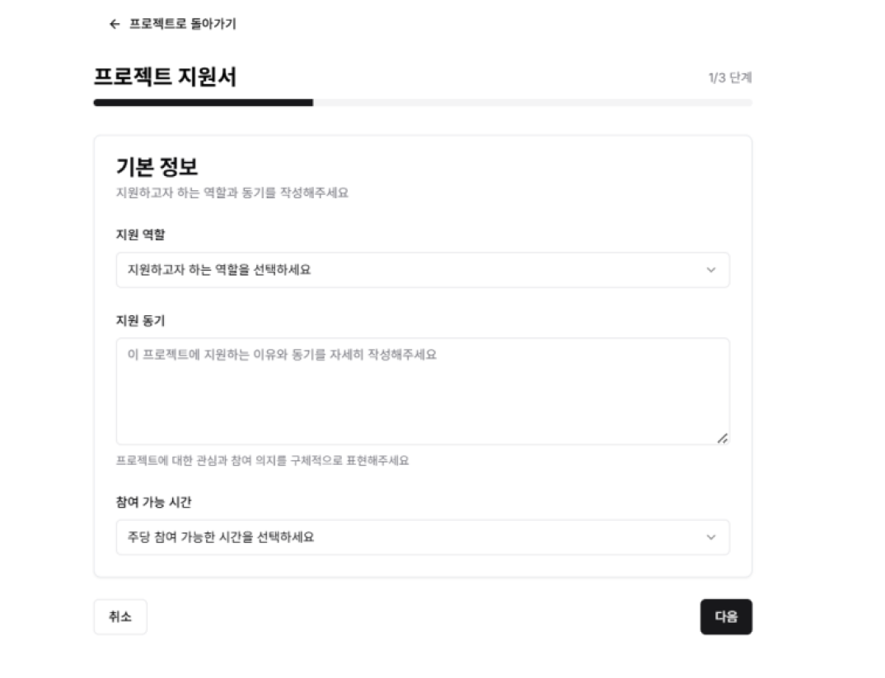
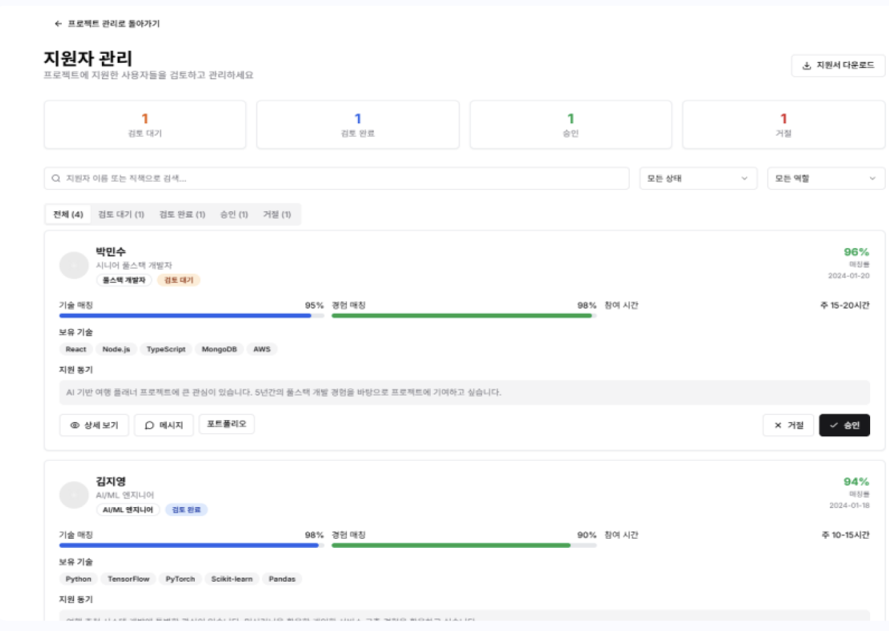

# AI 기반 사이드 프로젝트 매칭 플랫폼

> 사용자의 기술 스택, 전공, 경험, 선호 정보를 분석해서 **딱 맞는 사이드 프로젝트와 팀원을 추천**하는 웹 플랫폼

<p align="center">
  
</p>

## 📌 프로젝트 소개

사용자의 기술 스택, 전공, 경험, 선호 정보와 프로젝트 모집 공고를 분석해서 적합한 프로젝트와 팀원을 추천하는 웹 플랫폼입니다.
**SBERT 기반 문장 임베딩과 코사인 유사도**로 사용자와 프로젝트 사이의 매칭 점수를 계산하고, **GPT를 연동해 추천 이유와 적합도 설명**을 제공합니다.
사용자는 자신에게 맞는 프로젝트를 쉽게 찾을 수 있고, 모집자는 지원자를 선별하는 데 도움을 받을 수 있습니다.

- **기간**: 2025.03 ~ 2025.11
- **팀원**: 신경원, 안서진, 양유정, 권오승 (4명)

## 🙋 담당 역할

**SBERT 모델 학습·평가, 추천 로직 구현, Django 백엔드 개발**

- **SBERT 모델 학습 및 검증**
  - `(사용자 프로필, 프로젝트 설명, 유사도 점수)`로 구성된 데이터로 한국어 사전학습 SBERT 모델을 파인튜닝했습니다.
  - Pandas로 결측치를 처리하고 데이터를 학습용과 평가용으로 80:20 분리했습니다.
  - Pearson·Spearman 상관계수로 모델 출력과 정답 점수가 얼마나 일치하는지 평가했습니다. 최종 Spearman은 **0.952**입니다.
- **임베딩 기반 추천 로직 구현**
  - 사용자와 프로젝트의 기술 스택, 프로필 정보를 각각 임베딩하고 코사인 유사도를 계산했습니다.
  - 기술 스택 유사도와 프로필 유사도를 **60:40으로 가중 결합**해서 매칭 점수를 계산하고, 점수 순으로 추천 순위를 제공했습니다.
- **Django 기반 AI 기능 연동**
  - Django ORM으로 사용자·프로젝트 임베딩과 매칭 결과를 저장하고 조회하는 로직을 구현했습니다.
  - 모델 추론과 추천 점수 계산을 백엔드에 연동했습니다.
  - Django signals를 적용해서 데이터를 저장하면 임베딩이 자동으로 생성되도록 했습니다.

**주요 사용 기술**: Python, Pandas, NumPy, Sentence Transformers (SBERT), PyTorch, Django

## ✨ 주요 기능

| 기능 | 설명 |
|---|---|
| **AI 프로젝트 추천** | 로그인한 사용자에게 모집 중인 프로젝트를 매칭률 순으로 추천합니다 |
| **매칭 근거 설명** | GPT가 기술 매칭, 성향 적합도, 경험 수준 점수와 긍정/부정 요인, 개선 조언을 제공합니다 |
| **팀원 추천** | 프로젝트 생성자에게 임베딩 유사도가 높은 후보 사용자를 추천하고, 참여 제안을 보낼 수 있습니다 |
| **상세 프로필** | 기술 스택, 협업 방식, 미팅 빈도, Belbin 팀 역할, 선호 주제, 활동 지역 등을 입력합니다 |
| **지원 및 지원자 관리** | 프로젝트 지원서 작성, 지원자 수락/거절, 알림을 제공합니다 |
| **프로젝트 검색** | 키워드와 필터로 프로젝트를 검색합니다 |

<p align="center">
  
  
</p>
<p align="center">
  
  
</p>

## 🛠 기술 스택

| 분류 | 기술 |
|---|---|
| **Frontend** | React 19, TypeScript, Vite, Tailwind CSS 4, React Hook Form + Yup, Axios |
| **Backend** | Django 5.2, Django REST Framework, SimpleJWT |
| **AI / ML** | Sentence-Transformers (KR-SBERT), PyTorch, OpenAI API (gpt-4o-mini) |
| **Async** | Celery, Redis |
| **DB** | PostgreSQL |

## 🏗 아키텍처

```
┌──────────────┐   REST + JWT   ┌──────────────────────┐
│ React (Vite) │ ─────────────▶ │ Django REST Framework │
│              │                │                       │
└──────────────┘                └──────┬───────┬───────┘
                                       │       │ 작업 발행
                                       │       ▼
                                       │  ┌─────────┐   ┌──────────────────┐
                                       │  │  Redis  │──▶│  Celery Worker    │
                                       │  └─────────┘   │  · SBERT 임베딩    │
                                       │                │  · 매칭 점수 계산  │
                                       ▼                │  · GPT 설명 생성   │
                                ┌────────────┐          └────────┬─────────┘
                                │ PostgreSQL │◀──────────────────┘
                                └────────────┘
```

## 🤖 매칭 알고리즘

### 1. SBERT 파인튜닝
- **베이스 모델**: [`snunlp/KR-SBERT-V40K-klueNLI-augSTS`](https://huggingface.co/snunlp/KR-SBERT-V40K-klueNLI-augSTS)
- **데이터**: `(사용자 프로필, 프로젝트 설명, 적합도 점수 0~1)` 쌍 1,000개 (`matching_dataset.csv`)
  - 실제 매칭 데이터가 없어서 **규칙 기반으로 합성 데이터를 만들었습니다**. 사용자 프로필(지역, 경력, 기술 스택, 전공, 협업 방식)과 프로젝트 공고(지역, 요구 스택, 요구 경력, 특이사항)를 조합했습니다.
  - 점수는 **기술 스택 일치도**(동일 / 같은 계열, 예: Django↔Flask, React↔Next.js / 무관), **활동 지역 일치**, **요구 경력 충족 여부**에 따라 0.0, 0.2, 0.4, 0.9, 1.0 중 하나를 부여했습니다.
- **학습**: 학습/검증 8:2 분할, `CosineSimilarityLoss`, 4 epochs
- **결과** (검증셋):

| 지표 | 학습 초기 (step 10) | 최종 (epoch 4) |
|---|---|---|
| Cosine Pearson | 0.296 | **0.991** |
| Cosine Spearman | 0.214 | **0.952** |

### 2. 매칭률 계산
사용자와 프로젝트 정보를 **기술 영역**과 **프로필 영역**으로 나눠 각각 임베딩하고, 두 영역의 코사인 유사도를 가중 평균합니다.

```
매칭률 = min(100, 20 + (기술 유사도 × 0.6 + 프로필 유사도 × 0.4) × 100)
```

### 3. GPT 설명 생성
계산된 매칭률과 양쪽 정보를 `gpt-4o-mini`에 전달하고, JSON 모드로 아래 내용을 받습니다.
- 세부 점수: 기술 매칭, 성향 적합도, 경험 수준
- 추천 페이지용 요약: 핵심 이유 1개, 추가 이유 1~2개
- 상세 페이지용 분석: 긍정 요인, 부정 요인, 개선 조언

### 4. 성능 최적화
- 프로필이나 프로젝트를 저장하면 **Django signal로 임베딩을 자동 갱신**합니다.
- 매칭 점수는 **Celery 작업으로 미리 계산**하고 `MatchScores` 테이블에 캐싱합니다. 그래서 추천 페이지를 열 때 GPT 호출을 기다리지 않습니다.
- 프론트엔드는 `useScorePoller` 훅으로 계산이 끝났는지 폴링합니다.

## 📁 폴더 구조

```
finalproject/PROJECT111/
├── backend/
│   ├── config/            # Django 설정, Celery 설정
│   ├── teamspace/
│   │   ├── ai_services.py # 임베딩, 유사도, GPT 설명, MatchService
│   │   ├── tasks.py       # Celery 매칭 사전 계산 작업
│   │   ├── signals.py     # 저장 시 임베딩 자동 갱신
│   │   ├── models.py
│   │   ├── views.py
│   │   └── management/commands/  # 임베딩 생성, 시드 데이터 등
│   └── train_sbert.py     # SBERT 파인튜닝 스크립트
├── frontend/src/
│   ├── features/          # auth, projects, ai-recommendations, notifications, user-information
│   ├── pages/
│   ├── shared/            # 공통 컴포넌트, hooks, context
│   └── widgets/
└── mockup/                # 화면 캡처
```

## 🚀 실행 방법

### Backend
```bash
cd finalproject/PROJECT111/backend
python -m venv venv && source venv/bin/activate
pip install -r ../../../requirements.txt

# .env
# DATABASE_URL=postgres://...
# OPENAI_API_KEY=sk-...
# REDIS_URL=redis://localhost:6379/0

python manage.py migrate
python manage.py runserver

# 다른 터미널에서
celery -A config worker -l info
```

### Frontend
```bash
cd finalproject/PROJECT111/frontend
npm install
npm run dev
```

> 모델 가중치(`model.safetensors`)는 용량 문제로 레포에 포함하지 않았습니다. `python train_sbert.py`로 학습한 뒤 생성된 모델 폴더를 `backend/output/my_sbert_model/`(`settings.SBERT_MODEL_PATH`)에 두면 됩니다.

### 더미 데이터
```bash
python manage.py seed_dummy         # 소규모 (사용자 50 / 프로젝트 10)
python manage.py seed_dummy_large   # 대규모 (사용자 500 / 프로젝트 120)
```
